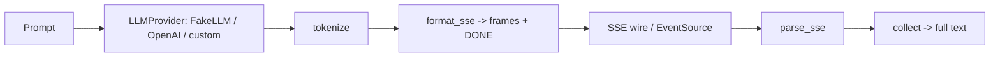

<p align="center">
  
</p>

<h1 align="center">LLM Streaming</h1>

<p align="center">
  <strong>LLM token streaming utilities — Server-Sent Events (SSE) formatting and parsing for streaming responses — in Python.</strong><br>
  Format tokens into correct SSE frames, parse them back, and reassemble the full completion — provider-agnostic and fully offline-capable.
</p>

<p align="center">
  <em>Built and maintained by <a href="https://viprasol.com">Viprasol Tech</a> — Fintech Experts. Full-Stack Builders.</em>
</p>

<p align="center">
  <a href="https://github.com/Viprasol-Tech/llm-streaming/actions/workflows/ci.yml"></a>
  <a href="LICENSE"></a>
  
  <a href="https://t.me/viprasol_help"></a>
  <a href="https://github.com/Viprasol-Tech/llm-streaming/stargazers"></a>
</p>

---

> **Provider-agnostic & offline-capable.** The library never calls a model itself — it accepts a pluggable `LLMProvider` (`Callable[[str], str]`). A deterministic, built-in **fake provider** ships with the package, so the demo and the entire test suite run with **no API keys and no network**. Swap in OpenAI, a local model, or anything else with one line.

---

## Features

- **Correct SSE wire format** — `format_sse(data, event=None)` emits spec-compliant frames (`event: ...\ndata: ...\n\n`), including proper multi-line `data:` handling.
- **Robust parser** — `parse_sse(text)` round-trips frames back into typed `(event, data)` events; handles multi-line data, CRLF, comments, and trailing partial frames.
- **Token streaming** — `stream_tokens(tokens)` yields one SSE frame per token plus a final `[DONE]` sentinel, mirroring OpenAI-style streams.
- **Lossless reassembly** — `collect(frames)` rebuilds the exact original text from parsed frames.
- **Pluggable providers** — bring your own `Callable[[str], str]`; a deterministic `FakeLLM` and `echo_llm` are included for offline use.
- **CLI demo** — `llm-streaming demo` streams a sentence token-by-token and prints every frame.
- **Modern tooling** — ruff, mypy (strict), pytest, GitHub Actions CI.

## Quickstart

```bash
git clone https://github.com/Viprasol-Tech/llm-streaming.git
cd llm-streaming
python -m pip install -e ".[dev]"

# Stream a sentence token-by-token over SSE (fully offline):
llm-streaming demo
```

## Plug in a real provider

The model call is a one-line swap — anything that maps a prompt to a string works:

```python
from llm_streaming import collect, stream_completion

# Built-in offline fake (no network):
from llm_streaming import FakeLLM
provider = FakeLLM(responses={"Hello?": "Hi there, streamed token by token."})

# ...or wrap a real model. Any Callable[[str], str] is a valid provider:
# from openai import OpenAI
# client = OpenAI()
# def provider(prompt: str) -> str:
#     return client.chat.completions.create(
#         model="gpt-4o-mini",
#         messages=[{"role": "user", "content": prompt}],
#     ).choices[0].message.content or ""

frames = list(stream_completion("Hello?", provider))   # SSE frames + [DONE]
for frame in frames:
    print(frame, end="")                                 # send these over the wire

print(collect(frames))   # reassemble the exact completion text
```

## Architecture



## Roadmap

- [x] SSE `format_sse` / `parse_sse` with multi-line + CRLF handling
- [x] Token streaming with `[DONE]` sentinel and lossless `collect`
- [x] Pluggable provider protocol + offline `FakeLLM`
- [ ] Async generators and `asyncio` streaming helpers
- [ ] OpenAI-style JSON delta chunk encoding/decoding
- [ ] Backpressure-aware framing for large payloads

## Contributing

PRs welcome — see [CONTRIBUTING.md](CONTRIBUTING.md) and our [Code of Conduct](CODE_OF_CONDUCT.md).

> **Note:** this library is open-source and not production-hardened — review the code before using it in production.

## Contact — Viprasol Tech Private Limited

- Website: [viprasol.com](https://viprasol.com)
- Email: [support@viprasol.com](mailto:support@viprasol.com)
- Telegram: [t.me/viprasol_help](https://t.me/viprasol_help) | WhatsApp: +91 96336 52112
- GitHub: [@Viprasol-Tech](https://github.com/Viprasol-Tech) | [LinkedIn](https://www.linkedin.com/in/viprasol/) | X [@viprasol](https://twitter.com/viprasol)

## License

[MIT](LICENSE) (c) 2025 Viprasol Tech Private Limited
